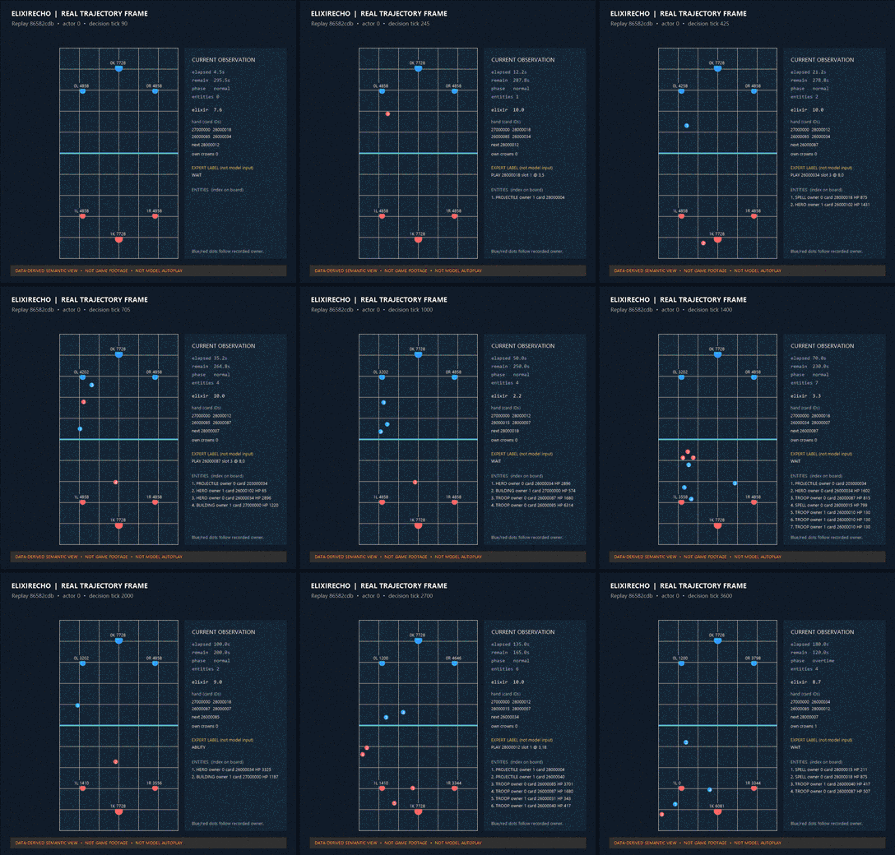

# ElixirEcho

[简体中文](README.md) · [English](README.en.md)

Every Clash Royale decision depends on the elixir, hand, battlefield, and opponent actions at that moment. Training from replays is not just a matter of reading which card a player used. The system must reconstruct the information available to one player at the decision boundary and align it with the corresponding action in time.

ElixirEcho turns full replays into auditable, two-player decision sequences and connects those sequences to recurrent imitation learning with FirstLight V4. This repository implements replay integration, semantic state and action contracts, trajectory storage, causal temporal state, V4 input adaptation, and training orchestration. The Native battle environment, V4 network, and core IL loss come from the external FirstLight project.



## What it does

- **Reconstructs replay decision points.** `capture` connects to a running FirstLight Native/BattleEnv service, samples both players every five game ticks, and builds the current Observation and ActionMask before the current action takes effect. The current capture path starts at tick 90 and pairs both actors under the same episode and tick identity. [Replay adapter](src/elixir_echo/integrations/firstlight/replay.py)
- **Stores complete, verifiable matches.** Each `DecisionStep` pairs a player-view Observation, legal-action mask, and expert action under `(episode_id, tick, actor)`. `TrajectoryWriter` stages a complete episode, checks ordering, identity, and hashes, then commits it atomically. The training reader exposes only fields needed by the training path. [Decision record](src/elixir_echo/domain/trajectory.py) · [Trajectory and reader](src/elixir_echo/datasets/trajectory.py)
- **Builds history in causal order.** `History` receives the current action only after the input for that decision has been formed. `PublicStateTracker` derives revealed cards and play history from public events observed so far. A prior action that the model input cannot represent stays unknown instead of being fabricated as WAIT. [History](src/elixir_echo/temporal/history.py) · [Tracker](src/elixir_echo/temporal/public_state.py)
- **Compiles semantic state into V4 inputs.** `MIN` and `RICH` select different levels of Observation detail; the Tensorizer converts the selected state and temporal context into FirstLight V4 tensors. The stored world record and the features seen by the model remain separately inspectable. [Profiles](src/elixir_echo/profiles/observation.py) · [Tensorizer](src/elixir_echo/integrations/firstlight/tensorizer.py)
- **Runs recurrent imitation learning by episode.** ElixirEcho's training orchestration carries LSTM state along each actor sequence, backpropagates in TBPTT chunks, updates with AdamW, and saves the model, optimizer, training progress, and data fingerprints. The first supervision pass supports WAIT and single `play_card` labels; unsupported ability, multi-action, and delay labels are not recast as WAIT. [Training entry point](src/elixir_echo/training/firstlight_run.py) · [Training orchestration](src/elixir_echo/integrations/firstlight/trainer.py)

## From replay to checkpoint

1. **Read the replay and reconstruct the match.** FirstLight Native/BattleEnv rebuilds the match from replay commands. At each decision boundary, ElixirEcho obtains the current state and legal actions available to each actor.
2. **Keep state and action labels separate.** `Observation` describes information available to the player at that moment, `ActionMask` describes legal choices, and `ExpertAction` records the replayed move. The label supervises the model; it is not fed back into that decision's input.
3. **Write a complete Trajectory.** Records are aligned by episode, tick, and actor, then written only after ordering, completeness, and hash checks pass. The full sequence preserves match order and gives recurrent state an episode-level reset boundary.
4. **Prepare temporal model input.** `TrainingTrajectoryReader` removes episode-level reconstruction data from the training projection. `History` and `PublicStateTracker` update context only from information available up to the current decision. The selected RICH profile and Tensorizer produce V4 tensors.
5. **Train and save weights.** FirstLight V4 predicts actions. Its IL loss compares those predictions with expert labels; ElixirEcho applies TBPTT and AdamW updates and saves a resumable checkpoint after complete episodes.

## Architecture

```mermaid
flowchart LR
  subgraph Capture[Replay reconstruction]
    direction TB
    Replay[Replay] --> Native[FirstLight Native / BattleEnv]
    Native --> State[Actor-fair Observation + ActionMask]
    Replay --> Label[ExpertAction label]
    State --> Step[DecisionStep]
    Label --> Step
    Step --> Store[Full-episode Trajectory]
  end
  subgraph Prepare[Temporal input]
    direction TB
    Reader[TrainingTrajectoryReader] --> Temporal[History + PublicStateTracker]
    Temporal --> Tensorizer[ElixirEcho Tensorizer]
  end
  subgraph Train[Imitation learning]
    direction TB
    V4[FirstLight V4 + LSTM] --> Loss[FirstLight IL loss]
    Loss --> Updates[TBPTT + AdamW]
    Updates --> Checkpoint[Checkpoint + fingerprints]
  end
  Store --> Reader
  Tensorizer --> V4
  Reader -. expert-label supervision .-> Loss
```



## Design choices

**A replay contains more than a player can observe.** Reconstruction may need both full decks and the complete event stream, but those facts should not automatically become one actor's model input. `TrainingTrajectoryReader` exposes only Observation, ActionMask, public event deltas, and action labels to the training path. The current action label enters the supervision path only.

**History must follow decision causality.** The system forms the input using information available through tick `t`, then commits the action from `t` for later decisions. The tracker does not read future records or infer facts that the current input cannot establish. This preserves useful temporal context without leaking the current label.

**Store semantic facts before choosing model features.** Observation is the auditable world record; MIN and RICH are field views; the Tensorizer decides how selected fields become model tensors. Adding a semantic field does not require making it a neural feature or changing the replay provider.

## Run results

| Work | Result |
| --- | --- |
| Fixed replay capture | One match sampled from tick 90 through 3600: **703 decision points and 1,406 paired-player records**. The replay reached `terminated`; trajectory checks and current-action leakage assertions passed. |
| Full-episode training and restore | A separate run trained from the previously archived Trajectory for this replay and completed **44 optimizer updates**. A fresh process restored the model, AdamW, and training progress and ran a finite RICH forward pass. |

Capture and training were separate acceptance runs; training used the archived Trajectory rather than running immediately after capture. These results show that the engineering path works for a fixed sample. They do not establish large-scale training or gameplay strength. See [Demo and Results](docs/demo-results.md) for timings, checkpoint details, and limitations.

## Quick start

The base environment requires Python 3.12+ and [uv](https://docs.astral.sh/uv/):

```powershell
uv sync --extra dev
uv run elixir-echo --help
uv run elixir-echo fixture --output ".\runs\fixture-demo"
```

`fixture` uses a synthetic episode and a small fake policy to check the data and control path; it does not train a Clash Royale policy. Verify an existing Trajectory with:

```powershell
uv run elixir-echo verify-trajectory "<trajectory-store>"
```

Real capture also requires user-supplied IL_Replay Parquet data, a compatible FirstLight checkout, game assets, and a running Native service. `capture` runs preflight by default; add `--run` to connect and capture. `train-firstlight` prints a plan by default and executes only with `--run`. See [Reproducibility](docs/reproducibility.md) for the full setup and commands.

## Dependencies, documentation, and limits

The base CLI requires Python 3.12+. The `firstlight-capture` extra provides PyArrow for Parquet input; training also requires a PyTorch/CUDA setup compatible with FirstLight and the host GPU. FirstLight is a separate checkout and is not installed by `uv sync`.

[Architecture](docs/architecture.md) · [Demo and Results](docs/demo-results.md) · [Model Card](docs/model-card.md) · [Reproducibility](docs/reproducibility.md) · [Migration Map](docs/provenance/migration-map.md) · [Third-party Notices](THIRD_PARTY_NOTICES.md)

FirstLight provides Native/BattleEnv, the V4 encoder and action heads, recurrent model, and core IL loss. ElixirEcho implements the contracts, full-episode Trajectory, temporal state, Tensorizer integration, and training orchestration in this repository. Semantic rules and temporal handling include code migrated and adapted from an earlier personal research project; the migration map records the boundaries. The upstream project is [FirstLight CR](https://github.com/Jaasssoooonnnnn/FirstLight_CR).

Replay reconstruction success across arbitrary matches, batch capture, multi-match formal training, clean-machine Native setup, and gameplay performance remain unverified. FirstLight source, game assets, source replays, and model weights are not bundled. Apache-2.0 applies only to ElixirEcho code its owner is entitled to license; it does not extend to third-party assets or weights. See [LICENSE](LICENSE). This project is not affiliated with the game publisher.
