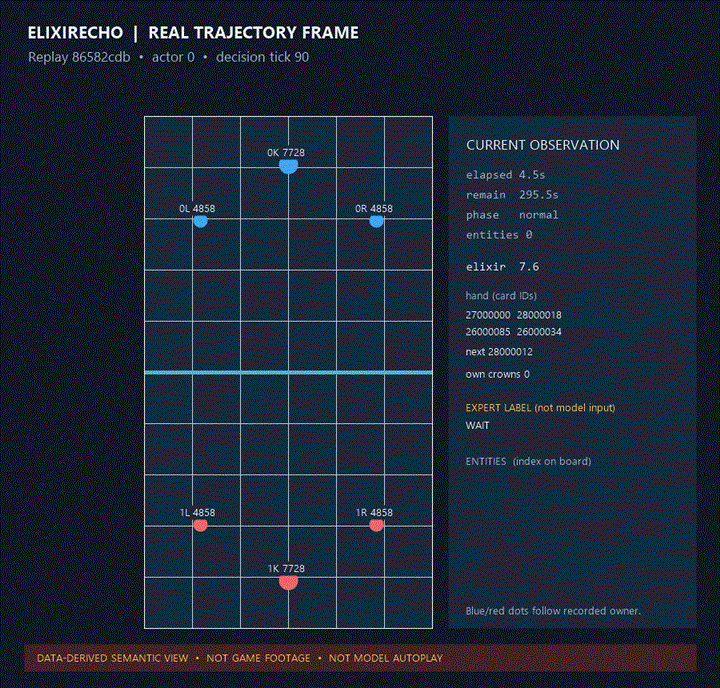

# ElixirEcho | 圣水回响

[简体中文](README.md) · [English](README.en.md)

*Learning to echo human elixir decisions.*

## Project overview

ElixirEcho is a personal imitation-learning research project built around complete Clash Royale replay trajectories. Its focus is constructing fair, traceable sequential examples from full matches and connecting them to recurrent policies and imitation-learning training.

It is not an official Clash Royale project or a production-ready online bot. The project reuses FirstLight's Native runner, BattleEnv, V4 model, and training components where possible. ElixirEcho owns its semantic contracts, trajectory boundaries, public history, and integration code. FirstLight source, game assets, replay data, and model weights are not bundled here.

## Core technical contributions

- Defines actor-fair `Observation`, `ActionMask`, `DecisionStep`, and complete-match `Trajectory` contracts, aligning current state, legal actions, and expert labels by episode/tick/actor.
- Stores complete trajectories with atomic writes, per-record hashes, and an episode aggregate hash; the training reader does not expose episode decks or provider diagnostics.
- Uses causal `History` and a deterministic `PublicStateTracker` for public events, revealed opponent cards, and previous actions; unknown facts remain unknown.
- Provides `MIN` / `RICH` observation profiles and a FirstLight V4 adapter. Historical formal checkpoints use their compatible legacy input mode.
- Reuses the existing FirstLight V4 components for a real single-match capture, RICH input compilation, TBPTT debug updates, and an isolated checkpoint reload check.

## Data-flow architecture

```mermaid
flowchart LR
  Replay[Replay record] --> Native[FirstLight Native / BattleEnv]
  Native --> Capture[ElixirEcho capture adapter]
  Capture --> Frame[Observation + ActionMask]
  Frame --> Trajectory[Atomic full-episode Trajectory]
  Trajectory --> Temporal[History + deterministic public Tracker]
  Temporal --> Tensorizer[RICH V4 Tensorizer]
  Tensorizer --> Policy[FirstLight V4 recurrent policy / IL loss]
  Policy --> Checkpoint[Separate training and checkpoint integration]
```



FirstLight supplies the Native runner, BattleEnv, V4 encoders, recurrent policy, action heads, and core IL loss. ElixirEcho calls these components through read-only adapters and supplies its own data contracts and training orchestration. The FirstLight checkout remains external and unchanged.

## Experimental results

- **Formal checkpoint from the earlier research project:** its historical sealed-test evaluation covered 38 matches, 76 actor sequences, and 67,894 decision frames, with teacher-forced total IL loss 6.0717. This is an earlier-project result under its fingerprinted input contract, not an ElixirEcho retraining result or a win rate.
- **ElixirEcho real pipeline:** fixed replay `86582cdb2f0f4e8c94e9d9540d75e4cb` was reconstructed from tick 90 through tick 3600: 703 decision ticks and 1,406 actor records. Key semantics matched the old run and all 1,406 label-leakage checks passed. A randomly initialized debug model completed two 32-step TBPTT updates; its isolated checkpoint was saved, reloaded, and compared on a forward pass.
- **Historical checkpoint prediction demo:** the checkpoint's `legacy_checkpoint` input mode was used for ordered inference over all 1,406 records. Twenty comparisons were emitted at 10 ticks × 2 actors. Every sampled model prediction was WAIT; 12 of 16 comparable WAIT/single-card labels matched, while four single-card labels were predicted as WAIT. Four ability/multi-action labels are outside this checkpoint's supported action-head comparison. This is a fixed-sample demonstration, not a win-rate or held-out metric.

The fixed replay appears in the earlier Pilot20 `train` split. Its membership in the historical formal checkpoint's train/validation/test splits could not be confirmed by matching the same replay identity, so this comparison is **not described as held out**. The historical checkpoint and sealed data are not included in this repository.

See [Demo and Results](docs/demo-results.md) and the [model card](docs/model-card.md) for run details, checkpoint hashes, action comparisons, and limitations.

## Demo



This GIF draws the arena, towers, entities, current player information, and expert labels at 10 ticks from the saved real Trajectory above. It is a **data-derived semantic trajectory view**, not a game recording and not a model playing autonomously in the simulator. The sampled predictions from the historical checkpoint and reproduction command are documented in [Demo and Results](docs/demo-results.md).

## Quick start

The core package requires Python 3.12 or newer and [uv](https://docs.astral.sh/uv/).

```powershell
uv sync --extra dev
uv run pytest -q
uv run elixir-echo --help
```

The base package has no runtime dependencies. Compatibility checks that require PyTorch, a FirstLight checkout, or a private replay cache skip when those resources are not configured. The FirstLight optimizer smoke runs only when `ELIXIR_ECHO_RUN_TRAINING_SMOKE=1` is explicitly set. Training commands print a plan by default and start only when `--run` is explicitly supplied with an episode cap.

## Verify a local trajectory

Point the command at an ElixirEcho Trajectory store root (the directory containing `episodes/`). It verifies episode and record hashes, ordering, identity, and full-match structure, then prints a summary through the training-safe reader.

```powershell
uv run elixir-echo verify-trajectory "D:\path\to\trajectory-cache"
```

The summary excludes episode context, full decks, provider diagnostics, and other audit-only metadata.

## Capture one fixed replay

Capture reuses the Native runner and the replay preparation, calibration, BattleEnv reset, and expert-command scheduling sequence already validated in the earlier research project. The Native service must already be running and reachable; this command does not launch MuMu.

Provide your own IL_Replay Parquet data, compatible FirstLight checkout, and Native game environment. First run the path preflight, which does not capture a replay:

```powershell
uv sync --extra dev --extra firstlight-capture
uv run elixir-echo capture `
  --replay-dataset "<local-IL_Replay-root>" `
  --replay-tag "<exact-replay-tag>" `
  --firstlight-root "<local-FirstLight-checkout>" `
  --output "<new-trajectory-cache-root>"
```

The preflight should report `ready: true` and `not_checked` for Native reachability. Add `--run` to connect to Native and process the requested replay. A missing identity or upstream reconstruction failure does not trigger a substitute replay. A complete match captures both actors from tick 90 every five ticks until a trusted terminated/truncated outcome and verifies the episode before atomic commit. The output must be outside the input dataset and FirstLight checkout.

One fixed replay has been validated. This does not establish that arbitrary replays will reconstruct successfully; batch capture is unverified. With `--debug-train`, keep output under an isolated `runs/real-replay-chain/<run-id>` directory. Replay data, game assets, and Native setup are user-supplied and not distributed.

## Capped training entry point

The training command first verifies the trajectory store and fingerprints only the training-safe projection. The first pass selects only terminated full episodes in the `train` split; validation, test, and truncated episodes are excluded. Without `--run`, it only prints a plan and does not import FirstLight/PyTorch, create a model, or write checkpoints.

```powershell
uv run elixir-echo train-firstlight `
  "D:\path\to\trajectory-cache" `
  --firstlight-root "<local-FirstLight-checkout>" `
  --checkpoint-directory "D:\path\to\elixirecho-checkpoints" `
  --max-episodes 2
```

Add `--run` after reviewing the plan. To resume from a saved checkpoint, pass `--resume-from`; the dataset fingerprint and episode prefix are checked first. Use `--device cuda` only after confirming that the local PyTorch build supports the target GPU. This entry point reuses the external FirstLight V4 model and loss. It is a capped research entry point, not evidence of model quality.

## Dependencies, provenance, and limitations

- **Core:** Python 3.12+; `uv` installs development dependencies. The optional `firstlight-capture` extra installs a Parquet reader; `firstlight-cache` installs safetensors and zstandard. Install the PyTorch build required by the local FirstLight CPU/CUDA setup separately.
- **FirstLight is external:** [FirstLight CR](https://github.com/Jaasssooooonnnn/FirstLight_CR). Its source, weights, and game resources are not vendored here; check upstream code and asset terms before use or redistribution.
- The historical formal checkpoint, sealed data, source IL_Replay data, and Native game resources are not included. The real-replay prediction script requires a compatible local checkpoint, trajectory, and FirstLight checkout.
- Verified capabilities are the fixed-replay pipeline, historical-checkpoint loading compatibility, and a small teacher-forced per-frame prediction display. Batch production, a complete independent training run, autonomous simulator play, and win rate are unverified. The model predicted only WAIT at the sampled points; successful prediction output does not mean the policy is useful.
- This repository does not yet declare a distribution license. It is not an official game tool and makes no production deployment or online-safety claim.

See [CONTEXT.md](CONTEXT.md) for domain vocabulary and ownership boundaries, [architecture](docs/architecture.md) for system structure, and [`docs/provenance`](docs/provenance/) for source and migration records.
