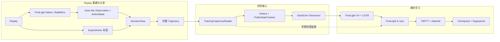

# 圣水回响

[简体中文](README.md) · [English](README.en.md)

《皇室战争》里的每一步决策都依赖当时的圣水、手牌、当前局势和对手动作。用对局回放训练模型时，不仅要读出“玩家打了哪张牌”：还要还原决策发生时、站在某一方视角真正可用的信息，并把它与对应动作按时间顺序配对。

ElixirEcho 将完整 Replay 转成可审计的双玩家决策序列，再把序列接入 FirstLight V4 的循环模仿学习训练。项目实现了回放接入、语义状态与动作契约、Trajectory 存储、因果历史状态、V4 输入适配和训练编排；Native 对局环境、V4 网络和核心 IL loss 来自外部 FirstLight。


这是模型在真实对战环境中的决策表现。模型基于 **500 场对局的语义重建数据**完成模仿学习训练，并在实战中自主进行出牌决策。


## 功能

- **从 Replay 重建决策时刻。** `capture` 连接已运行的 FirstLight Native/BattleEnv，按五个游戏 tick 采样双方状态，并在当前动作产生效果前构造 Observation 与 ActionMask。当前实现从 tick 90 开始，双玩家记录共享 episode 和 tick 身份。[采集适配器](src/elixir_echo/integrations/firstlight/replay.py)
- **保存完整、可校验的对局。** 每个 `DecisionStep` 将玩家视角的 Observation、合法动作掩码和专家动作配在同一身份 `(episode_id, tick, actor)` 下。TrajectoryWriter 按完整 episode 暂存记录，检查顺序、身份和哈希后原子提交；训练 Reader 只暴露模型训练所需的字段。[决策记录](src/elixir_echo/domain/trajectory.py) · [Trajectory 与 Reader](src/elixir_echo/datasets/trajectory.py)
- **按因果顺序处理历史。** `History` 在生成当前输入后才接收当前动作。`PublicStateTracker` 从截至当前时刻的公开事件恢复已揭示卡牌和出牌历史；上一动作无法由模型输入表示时明确标为 unknown，而不是伪造成 WAIT。[History](src/elixir_echo/temporal/history.py) · [Tracker](src/elixir_echo/temporal/public_state.py)
- **从语义状态编译 V4 输入。** `MIN` 与 `RICH` 选择不同粒度的 Observation 字段，Tensorizer 再把所选状态和时间上下文整理为 FirstLight V4 所需的张量。完整记录和模型实际接收的特征因此是两个可分别审计的层次。[Profile](src/elixir_echo/profiles/observation.py) · [Tensorizer](src/elixir_echo/integrations/firstlight/tensorizer.py)
- **按 episode 进行循环模仿学习。** ElixirEcho 的训练编排沿 actor 序列传递 LSTM 状态，以 TBPTT 分段反向传播，使用 AdamW 更新，并保存模型、优化器、训练进度与数据指纹。当前首轮监督范围是 WAIT 和单次 `play_card`；不支持的技能、多动作和 delay 标签不会被改写成 WAIT。[训练入口](src/elixir_echo/training/firstlight_run.py) · [训练编排](src/elixir_echo/integrations/firstlight/trainer.py)

## 工作流程

1. **读取 Replay 并重建局面。** FirstLight Native/BattleEnv 根据回放命令重建对局。ElixirEcho 在每个决策边界分别取得两个 actor 可用的当前状态和合法动作集合。
2. **分开保存状态与动作标签。** `Observation` 描述这一刻玩家能用的信息，`ActionMask` 描述可选动作，`ExpertAction` 记录回放中的专家操作。动作标签参与监督，但不会反向混入同一时刻的模型输入。
3. **形成完整 Trajectory。** 记录以 episode/tick/actor 对齐，经过顺序、完整性和哈希校验后写入存储。完整序列保留了局内的先后关系，训练时也能按对局重置循环状态。
4. **准备时序模型输入。** TrainingTrajectoryReader 去除训练不应读取的 episode 级重建信息；History 和 PublicStateTracker 仅基于当前及过去的可用信息更新上下文。Profile 与 Tensorizer 将语义记录转换为 RICH V4 张量。
5. **训练并保存权重。** FirstLight V4 产生动作预测，FirstLight IL loss 根据专家标签计算监督信号，ElixirEcho 使用 TBPTT 和 AdamW 更新模型，并按完整 episode 保存可恢复的 checkpoint。

## 技术架构



## 设计取舍

**Replay 知道的内容不等于玩家能看到的内容。** 重建对局可能需要读取双方完整牌组和完整事件，但这些重建信息不应自动成为某一方的模型输入。`TrainingTrajectoryReader` 只向训练链暴露 Observation、ActionMask、公开事件增量和动作标签；当前动作标签只进入监督路径。

**History 必须按决策因果推进。** 先用截至 tick `t` 的状态构造输入，再把 tick `t` 的专家动作写入历史，供后续时刻使用。Tracker 不读未来记录，也不推断当前输入无法证明的事实。这个顺序让历史信息可用于循环策略，同时避免当前标签泄漏。

**先保存语义事实，再选择模型特征。** Observation 是可审计的世界描述，MIN/RICH 是字段视图，Tensorizer 才决定如何将所选字段编码为模型张量。增加一个语义字段不等于它必须直接成为网络特征，也不需要因此改变 replay Provider。

## 运行结果

| 工作 | 实测结果 |
| --- | --- |
| 固定 Replay 采集 | 一场对局从 tick 90 采样至 tick 3600，共 **703 个决策时间点、1,406 条双玩家记录**；对局达到 `terminated`，Trajectory 与当前动作泄漏检查通过。 |
| 完整单局训练与恢复 | 使用此前归档的该 Replay Trajectory，完成 **44 次 optimizer update**；新进程恢复模型、AdamW 和训练进度，并成功运行有限值 RICH Forward。 |

采集和训练是分别执行的两次验收；训练使用归档 Trajectory，并非紧接在这次采集命令之后运行。这些结果证明固定样本上的工程链路可运行，不代表大规模训练或模型实战水平。详细时间、checkpoint、限制和来源见[演示与结果](docs/demo-results.md)。

## 快速开始

基础环境需要 Python 3.12+ 和 [uv](https://docs.astral.sh/uv/)：

```powershell
uv sync --extra dev
uv run elixir-echo --help
uv run elixir-echo fixture --output ".\runs\fixture-demo"
```

`fixture` 使用合成 episode 和小型 fake policy 检查数据与控制路径，不训练皇室战争策略。校验已有 Trajectory：

```powershell
uv run elixir-echo verify-trajectory "<trajectory-store>"
```

真实采集还需要用户自行准备 IL_Replay Parquet、兼容的 FirstLight checkout、游戏资源及已运行的 Native 服务。`capture` 默认只做预检；加 `--run` 才连接 Native 并采集。`train-firstlight` 默认输出训练计划，需显式加 `--run` 才会执行训练。完整环境和命令见[复现说明](docs/reproducibility.md)。

## 依赖、文档与限制

基础 CLI 使用 Python 3.12+；`firstlight-capture` extra 提供读取 Parquet 所需的 PyArrow，训练环境还需按 FirstLight 与本机 GPU 配置 PyTorch/CUDA。FirstLight 是独立 checkout，不会由 `uv sync` 下载或安装。

[架构说明](docs/architecture.md) · [演示与结果](docs/demo-results.md) · [模型卡](docs/model-card.md) · [复现说明](docs/reproducibility.md) · [代码迁移记录](docs/provenance/migration-map.md) · [第三方声明](THIRD_PARTY_NOTICES.md)

FirstLight 提供 Native/BattleEnv、V4 编码器与动作头、循环模型和核心 IL loss；ElixirEcho 负责本仓库中的数据契约、完整 Trajectory、历史状态、Tensorizer 接线与训练编排。语义规则和时序处理包含从早期个人研究工程迁移并适配的实现，迁移表列出具体边界。上游为[FirstLight CR](https://github.com/Jaasssoooonnnnn/FirstLight_CR)。

任意 Replay 的重建成功率、批量采集、多局正式训练、全新机器的 Native 部署和模型实战表现尚未验证。FirstLight 源码、游戏资源、原始 Replay 与模型权重不随本仓库分发。Apache-2.0 仅适用于项目所有者有权授权的 ElixirEcho 代码，不扩展到第三方素材或权重；见 [LICENSE](LICENSE)。本项目与游戏官方无隶属关系。
