# 圣水回响 | ElixirEcho

[简体中文](README.md) · [English](README.en.md)

*Learning to echo human elixir decisions.*

## 项目简介

圣水回响（ElixirEcho）是一个以皇室战争回放为素材的个人模仿学习研究项目，重点是从完整对局中构造公平、可追溯的时序样本，并将其接入循环策略与模仿学习训练。

它不是官方皇室战争项目，也不是可直接用于线上对战的机器人。项目尽量复用 FirstLight 的 Native、BattleEnv、V4 模型和训练组件；圣水回响负责自己的语义契约、轨迹边界、公开历史和接线代码。FirstLight 源码、游戏资源、回放数据和模型权重均未打包进本仓库。

## 核心技术贡献

- 定义 actor-fair 的 `Observation`、`ActionMask`、`DecisionStep` 与完整对局 `Trajectory`，将当前状态、合法动作和专家标签按 episode/tick/actor 对齐。
- 通过原子写入、逐记录哈希和 episode aggregate hash 保存完整轨迹；训练 reader 不暴露 episode deck 或 provider diagnostics。
- 用因果 `History` 与确定性 `PublicStateTracker` 管理公开事件、对手已暴露卡牌和 previous action；未知信息保持 unknown。
- 提供 `MIN` / `RICH` observation profiles 和 FirstLight V4 适配层；历史正式 checkpoint 使用其兼容输入模式。
- 复用既有 FirstLight V4 组件完成真实单局采集、RICH 输入编译与训练接线；G1 运行时 smoke、G3 单局训练及 G4 新进程恢复已通过。独立环境 G2 Native 再采集仍受外部数据和 Native 环境阻断。

## 数据流架构

```mermaid
flowchart LR
  Replay[回放记录] --> Native[FirstLight Native / BattleEnv]
  Native --> Capture[圣水回响采集适配层]
  Capture --> Frame[Observation + ActionMask]
  Frame --> Trajectory[原子完整对局 Trajectory]
  Trajectory --> Temporal[History + 确定性公开 Tracker]
  Temporal --> Tensorizer[RICH V4 Tensorizer]
  Tensorizer --> Policy[FirstLight V4 循环策略 / IL loss]
  Policy --> Checkpoint[独立训练与 checkpoint 接线]
```



FirstLight 提供 Native runner、BattleEnv、V4 编码器、循环策略、动作头和核心 IL loss。圣水回响通过只读适配器调用这些能力，并实现自己的数据契约与训练编排。项目没有复制或修改 FirstLight 原目录。

## 实验与运行结果

- **旧研究项目的正式 checkpoint**：历史封存测试覆盖 38 场、76 个 actor 序列、67,894 个决策帧；teacher-forced 总 IL loss 为 6.0717。这是旧项目在其指纹化输入契约上的评估，不是圣水回响重新训练的结果，也不是胜率。
- **G1 运行时验收**：在隔离环境中使用公开 FirstLight 原始 Provider 和 PyTorch 2.5.1+cu124，RTX 4070 Laptop 上指定的 V4/IL/checkpoint smoke 测试通过（1 项，14.63 秒）。这验证了受控的运行时训练与 checkpoint 路径，不验证 Native 采集。
- **G3/G4 单局训练验收**：使用只读归档的固定 replay `86582cdb2f0f4e8c94e9d9540d75e4cb`（terminated，train split，数据指纹 `f95d10b96731134a93597e79548c202902886288fe53984182363ba6047f499b`），完成 1,406 条 actor record 的 RICH 训练输入和 44 次 optimizer update，耗时 6 分 23 秒。隔离 checkpoint 保存后，在新进程中恢复模型、AdamW 与训练进度，并对同一 RICH 输入执行有限值 Forward。权重 SHA-256：`925055abb124804dc901f200739bafcb41c42f1b98e68f53233c3a691ea41d80`。这是一次完整单局工程训练验收，不是正式大规模训练或模型质量评估。
- **G2 独立 Native 采集：BLOCKED**。隔离预检在本轮检查的实验室外路径中未找到原始 IL_Replay Parquet，Native 控制端口也未监听；没有运行 `capture --run`。既有单局采集证据来自此前已配置的本地环境，不能当作干净公开环境的端到端验收。
- **旧正式 checkpoint 预测展示**：使用 checkpoint 的 `legacy_checkpoint` 输入兼容模式，对上述固定 replay 的 1,406 条记录顺序推理，在 10 个 tick × 2 个 actor 的 20 个采样点生成对照。样本中模型预测均为 WAIT；16 个 WAIT/单次出牌可比较标签中有 12 个一致，4 个单次出牌标签被预测为 WAIT；4 个技能/多动作标签不在该 checkpoint 的此动作头比较范围内。这只是固定样本展示，不是胜率或 held-out 指标。

固定 replay 出现在旧 Pilot20 的 `train` split。旧正式 checkpoint 的历史 train/validation/test 成员关系未能通过同一 replay identity 完整确认，因此本项目**不把这次对照称为 held-out 评估**。历史正式 checkpoint 与本地封存数据均不包含在仓库中。

详细运行数字、checkpoint 哈希、动作对照及局限见[演示与结果](docs/demo-results.md)和[模型卡](docs/model-card.md)。

## Demo

本仓库不分发由真实 replay 派生的 GIF。已验证的逐帧预测记录、运行数字和复现条件见[演示与结果](docs/demo-results.md)。

## 快速开始

核心包要求 Python 3.12 或更新版本及 [uv](https://docs.astral.sh/uv/)。

```powershell
uv sync --extra dev
uv run pytest -q
uv run elixir-echo --help
```

基础包没有运行时依赖。需要 PyTorch、FirstLight checkout 或私有回放缓存的兼容性检查会在对应资源未配置时跳过。FirstLight optimizer smoke 只有显式设置 `ELIXIR_ECHO_RUN_TRAINING_SMOKE=1` 才会运行。训练命令默认只生成计划；只有显式提供 `--run` 和 episode 上限才开始训练。

## 本地轨迹验证

将参数指向包含 `episodes/` 的圣水回响 Trajectory store 根目录。验证器检查 episode/record 哈希、顺序、identity 和完整对局结构，然后用训练安全 reader 输出摘要。

```powershell
uv run elixir-echo verify-trajectory "D:\path\to\trajectory-cache"
```

摘要不会导出 episode context、完整卡组、provider diagnostics 或其他仅用于审计的元数据。

## 真实固定回放采集

采集复用 FirstLight Native runner，以及旧研究项目验证过的 replay 准备、校准、BattleEnv reset 和专家命令调度顺序。Native 服务必须已启动并可连接；命令本身不会启动 MuMu。

准备用户自己的 IL_Replay Parquet 数据、兼容的 FirstLight checkout 和 Native 游戏环境。先运行不采集的路径预检：

```powershell
uv sync --extra dev --extra firstlight-capture
uv run elixir-echo capture `
  --replay-dataset "<local-IL_Replay-root>" `
  --replay-tag "<exact-replay-tag>" `
  --firstlight-root "<local-FirstLight-checkout>" `
  --output "<new-trajectory-cache-root>"
```

预检报告应显示 `ready: true`，并将 Native 可达性标为 `not_checked`。加上 `--run` 才会连接 Native 并处理指定 replay。identity 缺失或上游重建失败时不会替换成另一场。完整 episode 从 tick 90 起每 5 tick 同时采集两个 actor，直到可信的 terminated/truncated，并在原子提交前校验完整性。输出目录必须位于输入数据和 FirstLight checkout 之外。

此前已在本机已配置环境中完成一场固定 replay 的 Native 重建；不能据此推断任意回放都能重建成功。2026-10-25 的独立环境 G2 预检因原始 Parquet 与 Native 服务未就绪而为 BLOCKED，尚未证明使用者只凭公开代码、外部 Provider 和自备资源即可完成采集。批量采集仍未验证。使用 `--debug-train` 时，输出必须位于隔离的 `runs/real-replay-chain/<run-id>` 目录中。回放、游戏资源和 Native 均由使用者自行准备，不随仓库分发。

## 受限训练入口

训练命令先验证轨迹 store，并只从训练安全投影生成数据指纹。第一版仅选择 train split 中已 terminated 的完整 episode；validation、test 和 truncated episode 不进入训练。未提供 `--run` 时只打印计划，不导入 FirstLight/PyTorch、不创建模型、不写 checkpoint。

```powershell
uv run elixir-echo train-firstlight `
  "D:\path\to\trajectory-cache" `
  --firstlight-root "<local-FirstLight-checkout>" `
  --checkpoint-directory "D:\path\to\elixirecho-checkpoints" `
  --max-episodes 2
```

审阅计划后再附加 `--run`。从已保存 checkpoint 恢复时用 `--resume-from`，程序会先核对数据指纹与 episode 前缀。只有确认本机 PyTorch 支持目标 GPU 后才选择 `--device cuda`。该入口复用外部 FirstLight V4 模型和 loss，是有限额的研究入口，不代表模型质量。

## 依赖、来源与局限

- 核心：Python 3.12+；可用 `uv` 安装开发依赖。可选 `firstlight-capture` 安装 Parquet reader；`firstlight-cache` 安装 safetensors 与 zstandard。FirstLight 的 PyTorch/CUDA 环境需单独按本机配置准备。
- FirstLight 是外部依赖：[FirstLight CR](https://github.com/Jaasssoooonnnnn/FirstLight_CR)。它的源码、权重和游戏资源没有 vendored 到本仓库；使用或再分发前应核实上游代码与资产许可。
- 旧正式 checkpoint、封存数据、IL_Replay 原始数据和 Native 游戏资源未包含在仓库中。真实 replay 预测脚本需要本地提供兼容的 checkpoint、轨迹和 FirstLight checkout。
- 已验证 G1 运行时 smoke、G3 一场归档完整对局的 44 次更新、G4 新进程恢复，以及历史 checkpoint 的加载兼容和少量 teacher-forced 逐帧预测。G2 独立 Native 再采集、批量生产、多回放正式训练、自动化游戏实战和模型胜率尚未验证。G3 是单局工程验收，不代表模型质量；固定预测样本中模型只输出 WAIT。
- ElixirEcho 自有实现代码（`src/`、`tests/`、`tools/`）采用 Apache-2.0，见根目录 [LICENSE](LICENSE)。许可仅覆盖项目所有者有权授权的代码，不涵盖 FirstLight、IL_Replay 或其衍生回放素材、模型权重、游戏与 Native 资源；详见 [第三方声明](THIRD_PARTY_NOTICES.md)。项目不是官方游戏工具，也不承诺线上部署安全性。

概念和责任边界见 [CONTEXT.md](CONTEXT.md)，架构说明见[架构文档](docs/architecture.md)，来源与迁移记录见 [`docs/provenance`](docs/provenance/)。
