# 圣水回响 | ElixirEcho

*Learning to echo human elixir decisions.*

圣水回响 is a personal research project about learning game decisions from complete
Clash Royale replay trajectories. Its emphasis is the learning pipeline: actor-fair
semantics, episode-safe data, temporal inputs, and imitation-learning integration.

It is not an official Clash Royale project, a production bot, or a fork that bundles
FirstLight. The current policy integration reuses FirstLight V4 components through a
read-only adapter. ElixirEcho owns its domain contracts, observation profiles, cache
boundaries, temporal context, and integration layer; the long-term goal is to use this
foundation to investigate and train independent policies.

## Data flow

```mermaid
flowchart LR
  Replay[Replay record] --> Native[FirstLight Native and BattleEnv]
  Native --> Adapter[ElixirEcho capture adapter]
  Adapter --> Frame[Actor-fair Observation and ActionMask]
  Frame --> Trajectory[Atomic episode Trajectory]
  Trajectory --> Temporal[History and public Tracker]
  Temporal --> Tensorizer[RICH V4 Tensorizer]
  Tensorizer --> Policy[FirstLight V4 policy and IL loss]
  Policy --> Checkpoint[ElixirEcho training/checkpoint wrapper]
```



FirstLight supplies the external Native runner, BattleEnv, V4 encoders, recurrent
policy, action heads, and core imitation-learning loss. ElixirEcho calls these
components through adapters and supplies its own data contracts and training
orchestration; FirstLight source and assets are not vendored. The earlier local
research project produced the historical formal checkpoint and sealed evaluation
data. Neither those weights nor the private data are included here.

The [Demo/Results report](docs/demo-results.md) records one completed real-replay
capture through two TBPTT updates and a debug-checkpoint reload. This is a pipeline
smoke, not evidence of competitive play. Full batch production and a complete
ElixirEcho dataset-training run remain unverified; gameplay strength is also
unverified. The Native runner and V4 model/loss are upstream FirstLight components.
The earlier project's sealed-test result
is documented separately in the [model card](docs/model-card.md): 38 episodes,
67,894 decision frames, and teacher-forced IL loss 6.0717. It is not an ElixirEcho
retraining result or a gameplay win rate.

## What is here

- Canonical game-agent concepts: `Observation`, `ActionMask`, `DecisionStep`,
  `Trajectory`, `History`, `PublicStateTracker`, `PolicyInput`, and `RecurrentState`.
- Actor-fair minimum and rich observation selections exposed as
  `ObservationProfile.MIN` and `ObservationProfile.RICH`. `CORE` and `FULL` remain
  compatibility aliases, and the serialized values stay `core` and `full`.
- Atomic, hash-verified episode storage and a training-safe reader that does not expose
  episode decks or provider diagnostics.
- Causal public history and deterministic tracking, with unknown facts kept unknown.
- Optional read-only FirstLight V4 adapters for tensorization, policy inference, and
  imitation-learning compatibility checks.
- A fixed-replay capture command that reuses the earlier project's Native
  reconstruction sequence and writes ElixirEcho trajectories atomically.
- A read-only command for validating local trajectory caches.

The core package has no runtime dependencies. Replay data, checkpoints, game assets, and
machine-specific FirstLight paths are intentionally not included.

The formal checkpoint discussed in this repository was trained in the earlier local
research project. ElixirEcho has verified compatibility with that artifact; the
packaged code does not imply that it trained the weights again. The historical
checkpoint's sealed-test result is reported in the model card and is distinct from
the new single-replay debug run.
Historical checkpoint evaluation still calls that earlier project's read-only
loader and evaluator. ElixirEcho's Tensorizer and training orchestration were
adapted and partly rewritten for its own data contract.

## Quick start

Requirements: Python 3.12 or newer and [uv](https://docs.astral.sh/uv/).

```powershell
uv sync --extra dev
uv run pytest -q
uv run elixir-echo --help
```

The test suite exercises the local contracts and compatibility boundaries. Tests that
need PyTorch, a FirstLight checkout, or a private replay cache are optional and skip when
those resources are not configured. The FirstLight optimizer smoke is separately gated
by `ELIXIR_ECHO_RUN_TRAINING_SMOKE=1`. CLI training is dry-run by default and starts
only when `train-firstlight` is explicitly passed `--run` with a required episode cap.

## Verify a local trajectory cache

Point the command at an ElixirEcho trajectory-store root (the directory containing
`episodes/`). It verifies committed episode and record hashes, ordering, identity, and
full-episode structure, then prints a summary through the training-safe reader.

```powershell
uv run elixir-echo verify-trajectory "D:\path\to\trajectory-cache"
```

The report intentionally excludes episode context, complete decks, provider diagnostics,
and other audit-only metadata.

## Capture one fixed replay

Capture uses the existing FirstLight Native runner and the same preparation,
calibration, battle reset, and expert-command scheduling sequence used in the
earlier research project. It writes through ElixirEcho's `TrajectoryWriter`.
FirstLight must be running and reachable at its control host and port before
`--run`; this command connects to it but does not launch MuMu itself.

Install the optional Parquet reader and supply your own FirstLight checkout and
IL_Replay dataset. First inspect the paths without starting capture:

```powershell
uv sync --extra dev --extra firstlight-capture
uv run elixir-echo capture `
  --replay-dataset "<local-IL_Replay-root>" `
  --replay-tag "<exact-replay-tag>" `
  --firstlight-root "<local-FirstLight-checkout>" `
  --output "<new-trajectory-cache-root>"
```

The report must say `ready: true` for its path and argument checks; it reports
Native reachability as `not_checked`. Add `--run` to connect to the Native
service and capture exactly that replay.
The command never substitutes another replay if the identity is missing or
rejected. It captures both actors every five ticks from tick 90 through a
trusted terminal or truncation and verifies the complete episode before its
atomic commit. Output must be outside the input data and FirstLight checkout.
One fixed replay has completed this real Native capture path and the small
training/checkpoint smoke described in the [Demo/Results report](docs/demo-results.md).
This verifies that replay only; arbitrary replay acceptance and batch capture
remain unverified. Use `--debug-train` only with an output inside the isolated
`runs/real-replay-chain/<run-id>` directory.
Source data, game assets, and Native setup are user-supplied and are not
distributed in this repository.

The older sealed cache remains readable through the compatibility reader, so
capturing a new replay is unnecessary merely to examine or verify the existing
training work. See [architecture](docs/architecture.md),
[reproducibility](docs/reproducibility.md), and the
[data card](docs/data-card.md) for the ownership and validation boundaries.

## Plan or run a capped FirstLight training pass

The training command first verifies the trajectory store and builds a stable fingerprint
from the safe training projection only. It selects only terminated episodes in the
`train` split; validation, test, and truncated episodes never enter this first pass.
Without `--run`, the command only prints a plan and does not import FirstLight/PyTorch,
create a model, or write checkpoints.

```powershell
uv run elixir-echo train-firstlight `
  "D:\path\to\trajectory-cache" `
  --firstlight-root "<local-FirstLight-checkout>" `
  --checkpoint-directory "D:\path\to\elixirecho-checkpoints" `
  --max-episodes 2
```

After reviewing the plan, add `--run` to execute that capped pass. To continue from an
immutable checkpoint, pass its directory with `--resume-from`; the dataset fingerprint
and episode prefix are checked before model/optimizer state is restored. Choose `--device
cuda` only after confirming the installed PyTorch build supports the intended GPU.

```powershell
uv run elixir-echo train-firstlight `
  "D:\path\to\trajectory-cache" `
  --firstlight-root "<local-FirstLight-checkout>" `
  --checkpoint-directory "D:\path\to\elixirecho-checkpoints" `
  --max-episodes 2 `
  --checkpoint-every 1 `
  --device cuda `
  --run
```

Training uses the RICH profile and external FirstLight V4 model and loss through
ElixirEcho's training wrapper. This command is a capped research entry point,
not a claim of model quality or a recommendation to start large-scale training.

## Optional FirstLight compatibility checks

FirstLight remains an external, read-only checkout. Install a PyTorch build appropriate
for the local CPU/CUDA environment separately, then set the paths for the current shell:

```powershell
$env:ELIXIR_ECHO_FIRSTLIGHT_ROOT = "<local-FirstLight-checkout>"
$env:ELIXIR_ECHO_FIRSTLIGHT_CHECKPOINT = "D:\path\to\checkpoint-v1.pt"
uv run pytest -q tests/compatibility/test_firstlight_checkpoint_logits.py
```

That compatibility test loads the checkpoint and checks model outputs; it does not
optimize weights or save a checkpoint. The one-step optimizer smoke is opt-in and is not
run by normal setup:

```powershell
$env:ELIXIR_ECHO_RUN_TRAINING_SMOKE = "1"
uv run pytest -q tests/integration/test_firstlight_il_smoke.py
```

The runtime adapter disables bytecode writes into the configured FirstLight checkout.
For a historical checkpoint with its original sealed test cache, use the
[read-only evaluation procedure](docs/reproducibility.md#read-only-evaluation-of-a-historical-checkpoint).

The FirstLight integration is based on the external
[FirstLight CR project](https://github.com/Jaasssooooonnnn/FirstLight_CR), which is not
vendored here. Check the upstream repository's current license and asset terms before
redistributing upstream code, weights, or game resources. This repository does not yet
declare a distribution license.

## Current scope

This repository packages and validates the data-to-policy path; it does not claim a
measured competitive win rate or a production-ready standalone model. The current V4
integration is a compatibility baseline. New training runs and model-quality comparisons
are separate research steps, not automatic side effects of installing or testing the
package.

For the domain vocabulary and ownership boundaries, see [CONTEXT.md](CONTEXT.md). For
source and migration provenance, see [docs/provenance](docs/provenance/).
