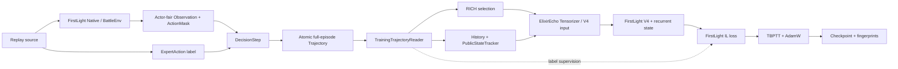

# Architecture

ElixirEcho owns the boundary between a reconstructed replay and a recurrent
imitation-learning run. FirstLight supplies Native reconstruction, BattleEnv,
the V4 network, and its imitation-loss implementation. The [migration map](provenance/migration-map.md)
distinguishes migrated research code from the new Trajectory and training
interfaces.

## Three boundaries

At each five-tick decision boundary, both actors get separate records with
the same episode and tick. `Observation` contains current facts available to
that actor, including its own private hand where applicable; `ActionMask`
describes currently allowed actions. The replay's expert command is paired as
a label, but its future effects cannot enter that decision's input. The
[replay adapter](../src/elixir_echo/integrations/firstlight/replay.py) checks
this boundary during capture. One delayed ability in the fixed replay has a
different execution tick from its observation tick; the exact execution-time
mask was not independently sampled. [Demo and Results](demo-results.md)
records that limitation.

`EpisodeContext` may contain both full decks to reproduce and verify the
match. The [training reader](../src/elixir_echo/datasets/trajectory.py) exposes
only decision identities, observations, masks, public event deltas, and labels.
`History.before_step` creates the current temporal view; the current action
enters history only after `after_action`. Unsupported real previous actions
remain explicitly masked instead of becoming WAIT. Replay splits are assigned
at the episode level, and the current trainer accepts terminated train
episodes only.

`Observation` is the stored semantic contract. `MIN` and `RICH` are field
selections; the [Tensorizer](../src/elixir_echo/integrations/firstlight/tensorizer.py)
builds V4 numeric inputs from the chosen selection and temporal context. The
training entry point currently fixes RICH and supervises WAIT plus single card
plays. Ability, multi-action, delay, and value training are outside this
first pass. Serialized `core/full` profile values and the
`legacy_checkpoint` input mode remain for compatibility with earlier assets.

## Evidence boundary

A fixed replay was captured with the original-source FirstLight Provider and
Native resources from an existing local deployment. A separate run trained
from an earlier archived Trajectory for the same replay ID and restored its
checkpoint in a fresh process. These checks establish the integration path on
that host. The historical formal checkpoint and its sealed-test loss belong to
the earlier research project; ElixirEcho has not repeated that training or
measured a gameplay win rate. See [Demo and Results](demo-results.md) and the
[model card](model-card.md).
