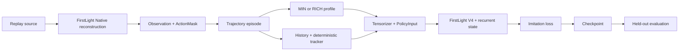

# Architecture

ElixirEcho studies imitation learning from full game replay trajectories. The
policy backbone and Native game reconstruction are FirstLight components used
through a read-only integration. The project-owned seams are actor-conditioned
semantics, episode storage, public temporal context, model input adaptation,
and the training and checkpoint workflow.

At tick `t`, the actor's Observation and ActionMask are paired atomically.
Public events through `t` may enter temporal processing; the expert action for
the current decision window is stored only as a supervision label. EpisodeContext
can contain both decks for replay verification, but the training reader never
exposes them. The actor's future and the opponent's private state are excluded.

`Observation` is a semantic current-state contract. `MIN` selects a complete
basic combat view. `RICH` includes additional approved dynamic details. The
Tensorizer then chooses the numeric features used by the FirstLight V4 wrapper.
These three levels are deliberately distinct. The `core/full` serialized profile
values are retained for compatibility with existing caches and checkpoints.

The earlier local project already implemented Native replay reconstruction.
ElixirEcho ports that call order into its FirstLight integration and uses its
existing `FirstLightReplayProvider` for the continuous five-tick timeline. The
earlier cache format stays readable; newly captured episodes use the atomic
ElixirEcho Trajectory format. See the [migration map](provenance/migration-map.md)
for exact code responsibilities.
