# Real replay training-chain demo

This note separates the earlier project's formal model from the new ElixirEcho
single-replay debug run. The debug run is a pipeline smoke, not a model-quality
result.

## Data flow

```mermaid
flowchart LR
  Replay[Fixed IL_Replay record] --> Native[FirstLight Native and BattleEnv]
  Native --> Capture[ElixirEcho actor-fair capture]
  Capture --> Trajectory[Isolated Trajectory train split]
  Trajectory --> Reader[TrainingTrajectoryReader]
  Reader --> Temporal[Existing public History and Tracker]
  Temporal --> Tensorizer[RICH V4 Tensorizer]
  Tensorizer --> Model[FirstLight V4 recurrent policy and action heads]
  Model --> IL[IL loss and AdamW, two 32-step TBPTT updates]
  IL --> Checkpoint[Separate debug checkpoint]
  Checkpoint --> Reload[Fresh V4 instance reload and forward]
```

The fixed source was replay `86582cdb2f0f4e8c94e9d9540d75e4cb`. ElixirEcho
used the existing FirstLight checkout; its `contracts.py` and `battle_env.py`
hashes matched the prior episode reference. The old-project cache was read-only
and used only for semantic comparison, not as this run's training input.

## Earlier project's formal result

The earlier local project already produced a formal recurrent V4 checkpoint at
`runs/checkpoint_v1_formal_epoch1/checkpoint-v1.pt` within that project's local
workspace. The weights are not included in this repository. Its recorded SHA-256 is
`49a76994020c49e60b3b7d90b7eaf7cc53ffaef3c679f3caa4130cb5c0c71548`.
The read-only historical test evaluation covered 38 episodes, 76 actor
sequences, and 67,894 decision frames, with teacher-forced total IL loss
6.0717. These are earlier-project results using the fingerprinted historical
input contract; ElixirEcho did not retrain or claim ownership of those weights.
See the [model card](model-card.md) for the full breakdown and limitations.

## ElixirEcho single-replay run

Capture completed with `terminated` outcome and assigned only to the isolated
debug `train` split:

| Check | Result |
| --- | ---: |
| Decision ticks | 703, ticks 90–3600 at five-tick intervals |
| Actor records | 1,406; both actors at each tick, strict `(tick, actor)` order |
| Label-leakage checks | 1,406; no current expert action entered its input |
| Trajectory aggregate SHA-256 | `eb3ed2ce26b5d443e52e847125f6c01d5ef6222fc4cb91bf25704c74219d9779` |
| New/old unexplained semantic differences | 0 |

The full new and old episodes matched on identity, termination, observations,
ActionMask, expert actions, and event deltas. The only serialization difference
was omission of `value: null` for optional `unknown`/`not_applicable` wrappers
in the new record; their status and all substantive values matched. The
training reader exposed no EpisodeContext or deck fields.

Both actor sequences compiled through the existing RICH input path (703
decisions each). Actor 0 had 681 WAIT, 18 single-card, 3 ability, and 1
multi-action labels; actor 1 had 663 WAIT, 39 single-card, and 1 ability label.
The debug update used only actor 0's first 64 decisions (ticks 90–405): 63
WAIT and one single-card action at tick 245. Unsupported labels were not
converted into training targets.

## TBPTT and checkpoint evidence

The V4 model used freshly randomized weights; no environment checkpoint was
configured or loaded. Training ran on an NVIDIA GeForce RTX 4070 Laptop GPU
with the existing RICH input contract and AdamW, using exactly two TBPTT
chunks of 32 decisions:

| Update | IL loss | Gradient norm |
| ---: | ---: | ---: |
| 1 | 8.5180 | 8.0751 |
| 2 | 0.1631 | 1.2604 |

The debug checkpoint is in the ignored local path
`runs/real-replay-chain/20261025-fixed-replay/debug-checkpoint`. It records
update step 2 and has no resumable episode progress. Its weights SHA-256 is
`a25773e979da363a8137a42872e2db177044b0190e77a23a50bde29da00bd17f`.
A fresh V4 instance loaded it successfully and ran forward on the same input:
gate logits had shape `[1, 2]`, candidate logits `[1, 6]`; maximum absolute
pre/post-reload differences were `0` and `2.38e-7` respectively.

The trajectory reader verification passed for one terminated episode and
1,406 records. The existing 21 focused capture/CLI tests had passed before
this real run; they were not rerun because no code changed during the run.

## Limits

- This proves one fixed replay can flow through real Native capture, the
  existing RICH/Tensorizer and V4 trainer, two TBPTT updates, and checkpoint
  reload. It does not measure playing strength.
- Only actor 0's 64-decision prefix was optimized. The debug checkpoint is
  intentionally separate and is not a formal or resumable training result.
- No batch capture, complete ElixirEcho dataset-training run, full model
  evaluation, or win-rate test was performed. The two updates are a debug smoke
  using upstream FirstLight V4 components. Ability and multi-action labels remain
  outside this first-pass loss.
- The historical formal checkpoint, sealed data, and legacy research checkout were not modified.
