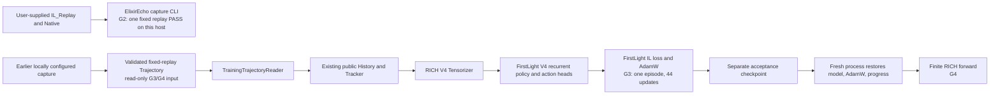

# Real replay training-chain demo

The README's 3×3 GIF (`docs/assets/trajectory-montage-3x3.gif`) is a semantic
state visualization, not game footage. Its action captions are expert labels,
not model predictions or executed model actions.

This note separates the earlier project's formal model, the earlier local
single-replay debug run, and the isolated G1–G4 engineering acceptance. G2
covers one fixed replay on this host using an existing Native deployment; it
does not establish clean-machine Native installation, batch capture, or model
quality. G3 proves a bounded single-episode training path, not large-scale
training.

## Data flow



The fixed source was replay `86582cdb2f0f4e8c94e9d9540d75e4cb`. ElixirEcho
used the existing FirstLight checkout; its `contracts.py` and `battle_env.py`
hashes matched the prior episode reference. The old-project cache was read-only
and used only for semantic comparison, not as this run's training input.

## G1 runtime smoke: PASS

The isolated environment ran the single approved integration test
`test_full_profile_sequence_runs_firstlight_v4_il_and_checkpoint_roundtrip`.
It passed in 14.63 seconds with PyTorch `2.5.1+cu124` and the raw public
FirstLight checkout on an RTX 4070 Laptop. This is a bounded V4/IL/checkpoint
runtime smoke; it does not test Native capture.

## G2 isolated Native capture: PASS for one fixed replay

The isolated ElixirEcho checkout captured replay
`86582cdb2f0f4e8c94e9d9540d75e4cb` from user-provided IL_Replay data. The run
reached trusted `terminated` at tick 3600 and produced 703 decision ticks from
tick 90 at five-tick intervals, with both actors at every tick: 1,406 records.
The existing trajectory verifier passed; record order, episode/tick/actor
identity, ActionMask identity and shape, and 1,406/1,406 label-leakage
assertions passed. The Trajectory aggregate hash is
`f5a46c23de779b1f41f7a2c02116bca0154cfd931b75c957a1d09fc978e0cfb4`; the
`records.jsonl` SHA-256 is
`4450B7D1CB0DB026A1EB62285CA364AF74932F80D64B37A3E235A0EEA90B84B7`.

The action counts are consistent: there are 1,344 empty-action records, which
the `ExpertAction` contract interprets as WAIT, and 62 non-WAIT records. One
non-WAIT window (actor 0, tick 3505) contains two ability actions, so the total
is 63 actions: 57 card plays and 6 abilities. All 57 card labels matched the
paired hand-slot mask.

Five ability labels were allowed by the ActionMask at their recorded frame.
One ability label is recorded at actor 0, tick 830, with
`execute_offset_ticks=+3`, while the mask at tick 830 says ability is not
currently available. The action belongs to the delayed window and occurred at
tick 833; that exact execution tick was not sampled separately. Therefore this
run does not claim that all ability actions were legal at the observation
instant or that the ActionMask was independently checked at every delayed
execution instant.

The capture used the original-source FirstLight checkout as its Provider, but
the Native service was launched with the existing local deployed FirstLight
environment and its built runtime resources. This validates one replay through
the isolated ElixirEcho capture path on this host. It is not a fresh-machine
installation test, does not establish Native deployment from the raw source
checkout alone, and does not establish arbitrary-replay or batch reliability.
The capture did not train a model.

## Earlier project's formal result

The earlier local project already produced a formal recurrent V4 checkpoint at
`runs/checkpoint_v1_formal_epoch1/checkpoint-v1.pt` within that project's local
workspace. The weights are not included in this repository. Its recorded SHA-256 is
`49a76994020c49e60b3b7d90b7eaf7cc53ffaef3c679f3caa4130cb5c0c71548`.
The read-only historical test evaluation covered 38 episodes, 76 actor
sequences, and 67,894 decision frames, with teacher-forced total IL loss
6.0717. These are earlier-project results using the fingerprinted historical
input contract; ElixirEcho did not retrain or claim ownership of those weights.
See the [model card](model-card.md) for the full breakdown and limitations.

## Earlier local capture and two-step debug smoke

Capture completed with `terminated` outcome and assigned only to the isolated
debug `train` split:

| Check | Result |
| --- | ---: |
| Decision ticks | 703, ticks 90–3600 at five-tick intervals |
| Actor records | 1,406; both actors at each tick, strict `(tick, actor)` order |
| Label-leakage checks | 1,406; no current expert action entered its input |
| Trajectory aggregate SHA-256 | `eb3ed2ce26b5d443e52e847125f6c01d5ef6222fc4cb91bf25704c74219d9779` |
| New/old unexplained semantic differences | 0 |

The full new and old episodes matched on identity, termination, observations,
ActionMask, expert actions, and event deltas. The only serialization difference
was omission of `value: null` for optional `unknown`/`not_applicable` wrappers
in the new record; their status and all substantive values matched. The
training reader exposed no EpisodeContext or deck fields.

Both actor sequences compiled through the existing RICH input path (703
decisions each). Actor 0 had 681 WAIT, 18 single-card, 3 ability, and 1
multi-action labels; actor 1 had 663 WAIT, 39 single-card, and 1 ability label.
The debug update used only actor 0's first 64 decisions (ticks 90–405): 63
WAIT and one single-card action at tick 245. Unsupported labels were not
converted into training targets.

## TBPTT and checkpoint evidence

The V4 model used freshly randomized weights; no environment checkpoint was
configured or loaded. Training ran on an NVIDIA GeForce RTX 4070 Laptop GPU
with the existing RICH input contract and AdamW, using exactly two TBPTT
chunks of 32 decisions:

| Update | IL loss | Gradient norm |
| ---: | ---: | ---: |
| 1 | 8.5180 | 8.0751 |
| 2 | 0.1631 | 1.2604 |

The debug checkpoint is in the ignored local path
`runs/real-replay-chain/20261025-fixed-replay/debug-checkpoint`. It records
update step 2 and has no resumable episode progress. Its weights SHA-256 is
`a25773e979da363a8137a42872e2db177044b0190e77a23a50bde29da00bd17f`.
A fresh V4 instance loaded it successfully and ran forward on the same input:
gate logits had shape `[1, 2]`, candidate logits `[1, 6]`; maximum absolute
pre/post-reload differences were `0` and `2.38e-7` respectively.

The trajectory reader verification passed for one terminated episode and
1,406 records. The existing 21 focused capture/CLI tests had passed before
this real run; they were not rerun because no code changed during the run.

## G3/G4 isolated single-episode training acceptance

G3 used the archived Trajectory read-only as the training input. The replay
was `86582cdb2f0f4e8c94e9d9540d75e4cb`, terminated, assigned to `train`, and
matched dataset fingerprint
`f95d10b96731134a93597e79548c202902886288fe53984182363ba6047f499b`. The
run used the raw public Provider, CUDA, and one terminated episode; it did not
resume from the historical formal checkpoint.

| Check | Result |
| --- | ---: |
| Decision ticks / actor records | 703 / 1,406 (703 per actor) |
| TBPTT length / optimizer updates | 32 / 44 |
| Elapsed training time | 6m 23s |
| Labels | 1,344 WAIT; 57 single play-card; 4 ability and 1 multi-action retained but unsupervised |
| Non-finite guards | No loss/gradient guard fired; per-step numeric loss, gradient norm, and parameter-delta reports were not emitted |
| Checkpoint | `episode-000001-step-00000044`; one completed episode, optimizer step 44 |
| Weights SHA-256 | `925055abb124804dc901f200739bafcb41c42f1b98e68f53233c3a691ea41d80` |

G4 used a separate Python process and fresh V4 instance. It restored model
weights, AdamW state, and progress metadata from that G3 checkpoint; all 373
restored optimizer parameter states had step 44. A RICH forward on actor 0,
tick 90 produced finite gate logits `[1, 2]` and candidate logits `[1, 6]`.
The training run did not preserve pre-save logits, so save/load logits parity
was **not measured**. These results validate one complete episode's engineering
path only; they do not constitute formal multi-replay training or a quality
evaluation.

## Historical formal checkpoint: fixed-replay prediction sample

The earlier project's formal checkpoint was loaded read-only from its local
path and evaluated through the existing FirstLight V4 `model.act` greedy
decoder. ElixirEcho supplied RICH observations using
`legacy_checkpoint` input mode. Both actor sequences were processed in tick
order with separate recurrent state, reset at each actor's first frame. This
was teacher-forced replay input: the recorded expert action was committed to
public history only after that frame's model input and prediction had been
formed. No game was simulated and no weights were changed.

| Check | Result |
| --- | ---: |
| Replay / outcome | `86582cdb2f0f4e8c94e9d9540d75e4cb` / terminated |
| Full sequence processed | 1,406 actor records (703 per actor) |
| Displayed comparison points | 20 (10 ticks × 2 actors) |
| Checkpoint SHA-256 | `49a76994020c49e60b3b7d90b7eaf7cc53ffaef3c679f3caa4130cb5c0c71548` |
| Tensorized candidate-slot mappings checked against ActionMask | 4,130; 0 errors |
| Frames where ActionMask allowed card play | 1,215 / 1,406 |
| Model output at sampled points | WAIT at all 20 points |
| Comparable WAIT / single-card labels | 12 / 16 matched; 4 single-card labels predicted as WAIT |
| Ability / multi-action labels | 4 sampled records; outside this action-head comparison |

Examples from actor 0 show the model's behavior and the current limits of the
old action heads:

| Tick | Expert action | Model output | Reading |
| ---: | --- | --- | --- |
| 90 | WAIT | WAIT | Match |
| 245 | Play card `28000018`, slot 1, grid `[3,5]` | WAIT | Mismatch |
| 425 | Play card `26000034`, slot 3, grid `[8,0]` | WAIT | Mismatch |
| 830 | Activate ability | WAIT | Not comparable to the checkpoint's WAIT/single-card labels |
| 1310 | Activate ability | WAIT | Not comparable; ActionMask reports ability available |
| 2700 | Play card `28000012`, slot 1, grid `[3,18]` | WAIT | Mismatch |
| 3505 | Two ability actions | WAIT | Not comparable to the checkpoint's action heads |
| 3600 | WAIT | WAIT | Match |

The decoder selected only ActionMask-backed candidates. For every selected
candidate it checks the native hand slot, visible card ID, and predicted target
grid against the same-tick ActionMask. Across the sequence, all 4,130
candidate-to-slot/card/placement mappings passed. These checks establish the
input and action decoding path; they do not establish policy quality. In
particular, the formal checkpoint's training report records no delay-head
supervision, so any decoded delay value must not be interpreted as learned
timing behavior.

The replay is assigned to `train` in the earlier Pilot20 split manifest. Its
membership in the historical formal checkpoint's own train/validation/test
sets could not be confirmed by matching the same identity. Therefore these
sampled comparisons are **not claimed as held out** and are not a formal
generalization evaluation. The fixed sample's 12/16 descriptive match count is
not a win rate.

To reproduce this local display, supply the saved trajectory, the compatible
FirstLight checkout, and the old checkpoint (none are distributed here):

```powershell
$env:PYTHONPATH = "<ElixirEcho-root>\src"
$env:PYTHONDONTWRITEBYTECODE = "1"
& "<python-with-PyTorch>" "<ElixirEcho-root>\tools\demo_fixed_replay_predictions.py" `
  --trajectory-root "<trajectory-store-root>" `
  --replay-id "86582cdb2f0f4e8c94e9d9540d75e4cb" `
  --firstlight-root "<FirstLight-checkout>" `
  --checkpoint "<formal-checkpoint-v1.pt>" `
  --output "<local-output.json>" `
  --device cuda
```

## Limits

- Earlier local capture evidence and the isolated G3/G4 training acceptance
  are separate results. G3 used the already archived trajectory; it did not
  revalidate Native replay capture in the isolated environment. It does not
  measure playing strength.
- The earlier two-update debug smoke optimized only actor 0's 64-decision
  prefix. Its checkpoint is separate and not resumable. G3 later trained on the
  complete archived episode and produced a different checkpoint.
- G2 passed for one fixed replay on this host using an existing Native
  deployment; clean-machine Native installation, batch capture, arbitrary
  replay reliability, multi-replay formal training, full model evaluation,
  and win-rate testing remain unverified. G3 covered one episode and 44 updates
  using upstream FirstLight V4 components. Ability and multi-action labels
  remain outside this first-pass loss.
- The historical formal checkpoint, sealed data, and legacy research checkout were not modified.
