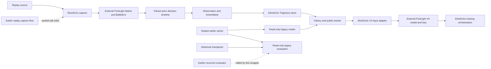

# Migration and verification map

ElixirEcho packages work from an earlier local research project. That project
produced full replay caches and the historical formal checkpoint. This map
distinguishes its results, code migrated into ElixirEcho, and FirstLight code
loaded from an external checkout. It does not claim that the checkpoint was
trained again in ElixirEcho.

The diagram describes available code paths, not an end-to-end verification
claim. In particular, the new `capture --run` path has not passed a real Native
replay test. The V4 backbone, recurrent model, and core imitation-loss
implementation are external FirstLight components; ElixirEcho has not rebuilt
them.

## Source-to-destination map

| Responsibility | Earlier implementation or external source | ElixirEcho implementation | Migration and verification boundary |
| --- | --- | --- | --- |
| Replay selection and Native calibration | Earlier `semantic_frame.firstlight_replay_smoke` and `semantic_frame.firstlight_full_episode`; external FirstLight `NativeClashEnv` and `BattleEnvV1` | `integrations.firstlight.capture` | The source preflight rule and preparation, calibration, reset, and expert-command scheduling order were ported and adapted to a one-replay CLI. Native and BattleEnv are imported from the configured external checkout. Mocked call-order tests exist; real `capture --run` has not been verified. |
| Paired actor decision timeline | Earlier `firstlight_full_episode.group_timed_expert_actions` and `capture_decision_timeline` | `integrations.firstlight.replay` | Five-tick, two-actor timing and the label-leakage boundary were migrated into the new trajectory contract. No separate game engine was built. |
| Actor-fair semantic input | Earlier `semantic_frame.contracts`, `firstlight_adapter`, and `profiles` | `domain.observation`, `integrations.firstlight.observation`, and `profiles.observation` | Field rules and MIN/RICH selection were migrated with contract and naming adaptations. Semantic parity tests cover selected legacy assets; they do not prove equivalence for every game mechanism. |
| Tensorizer and temporal V4 input | Earlier `training.tensorizer_v1` and `training.temporal_v4_input` | `integrations.firstlight.tensorizer` | **Substantial input assembly was rewritten** for ElixirEcho contracts. `legacy_checkpoint` preserves the historical input mode; representative tensor and checkpoint compatibility tests compare against the earlier implementation and sealed cache. The richer mode is a separate input contract. |
| Historical cache access | Earlier sealed FullEpisode and recurrent Layer 2 caches | `datasets.legacy` | Read-only compatibility readers map old records into the new domain. Historical caches and splits are neither copied into Git nor regenerated. |
| New trajectory storage | Earlier `semantic_frame.full_episode_cache.FullEpisodeCacheWriter` | `datasets.trajectory.TrajectoryWriter` and readers | **A different wire format and atomic writer were implemented.** The new store and old sealed cache coexist; the compatibility reader avoids a data rewrite. |
| History and public tracker | Earlier `training.history` and `training.deterministic_tracker` | `temporal.history`, `temporal.public_state`, and `temporal.policy_input` | Causal history, revealed-card tracking, previous-action status, and reset rules were migrated and refactored for the new `DecisionStep`. Tests check time ordering and leakage boundaries. |
| V4 encoder, LSTM, action head, and IL loss | External FirstLight `native_runner.training.v4` | `integrations.firstlight.policy`, `integrations.firstlight.trainer` | The model and core V4 loss are imported and called from the external checkout. No new backbone or new historical weights are claimed. |
| TBPTT, optimizer, training loop, and checkpoint orchestration | Earlier `training.recurrent_il` plus external FirstLight V4 | `integrations.firstlight.trainer` and `training.firstlight_run` | **Training scheduling, supervision wiring, resume, and checkpoint metadata were implemented again** for ElixirEcho's data contract. They overlap the earlier trainer. This is not proof that a new ElixirEcho run reproduced the earlier formal training. No refactor is required for this private delivery. |
| Historical checkpoint evaluation | Earlier `training.recurrent_il.load_checkpoint_v2`, `evaluate_recurrent_batches`, and sealed test stream | `tools/evaluate_legacy_checkpoint.py` | A thin read-only wrapper calls the earlier local project, its original V4 loader and loss, and the historical checkpoint. The completed sealed-test loss run covered 38 episodes, 76 actor sequences, and 67,894 decision frames. It is not a new ElixirEcho training result or a gameplay win rate. The wrapper still requires the earlier local project. |
| Decision diagnostics | Historical V4 outputs | `tools/evaluate_legacy_decisions.py` | An additional read-only tool has completed only a one-batch smoke: 2 episodes and 2,852 frames. No full-split decision result is claimed, and this analysis is not a private-delivery gate. |
| Batch capture and local startup | Earlier `tools.build_full_episode_cache` and local Native startup scripts | One exact-replay `capture` CLI | The full batch selection, resume, and machine startup workflow was not migrated. The local startup scripts contain machine-specific details and are not shipped. |

For stable concepts, public documentation uses `Observation`, `History`,
`Policy`, `MIN`, and `RICH`. Old `core/full` serialized profile values,
versioned wire identities, fingerprints, and `legacy_checkpoint` input mode
remain where required to read existing assets. Renaming those values would
break compatibility.

## Evidence levels and delivery boundary

| Evidence | What it supports | What it does not support |
| --- | --- | --- |
| Unit and selected legacy parity checks | Core contracts and selected old tensors, labels, and model outputs have matched in the configured test cases. | Universal equivalence across all mechanisms or machines. |
| Earlier formal checkpoint and sealed-test loss | The existing weights load under the old fingerprinted input contract, and the read-only evaluation path completed. | Independently trained ElixirEcho weights, competitive strength, or a win rate. |
| One-batch decision diagnostics | A bounded offline check of the existing checkpoint. | Full test-split action-quality conclusions. |
| Capture tests | Source selection and simulated Native call ordering. | A completed real Native replay through the new CLI. |
| Release audit | Prospective Git file hygiene at the time it was run. | A commit, push, remote visibility check, or review of future changes. |

For this private GitHub baseline, the remaining gates are accurate documentation,
bounded compatibility and clean-install checks, inspection of prospective Git
files, and verification of the destination repository. Native capture, new
formal training, full decision analysis, and online play are separate future
work. They must remain labelled unverified until tested.

`source-inventory.json` is a historical inventory of the earlier local
research workspace. It excludes generated caches and weights. It is not an
inventory of the current ElixirEcho worktree and does not grant rights to
third-party code, replay data, or game assets. See `THIRD_PARTY_NOTICES.md`
for attribution and distribution boundaries.
