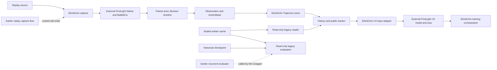

# Migration and verification map

ElixirEcho packages work from an earlier local research project. That project
produced full replay caches and the historical formal checkpoint. This map
distinguishes its results, code migrated into ElixirEcho, and components loaded
from the public [FirstLight CR repository](https://github.com/Jaasssoooonnnnn/FirstLight_CR).
It does not claim that the historical formal checkpoint was trained again in
ElixirEcho.

An earlier locally configured environment completed one real Native
reconstruction and a two-update debug run. G1 runtime smoke, G2 single-replay
Native capture, and G3/G4 single-episode training/reload acceptance have now
passed in the isolated ElixirEcho environment. G3 used an already archived,
read-only Trajectory. For G2, the Provider was the original-source checkout at
`D:\FirstLight_CR-main`; the Native service was started through the existing
deployment at `D:\Downloads\FirstLight_CR-main`, which supplied its built
runtime resources and local compatibility. This hybrid local setup is not a
fresh-machine installation test and does not establish arbitrary-replay or
batch reliability. The V4 backbone, recurrent model, and core imitation-loss
implementation are external FirstLight components; ElixirEcho has not rebuilt
them.

## Source-to-destination map

| Responsibility | Earlier implementation or external source | ElixirEcho implementation | Migration and verification boundary |
| --- | --- | --- | --- |
| Replay selection and Native calibration | Earlier `semantic_frame.firstlight_replay_smoke` and `semantic_frame.firstlight_full_episode`; external FirstLight `NativeClashEnv` and `BattleEnvV1` | `integrations.firstlight.capture` | The source preflight rule and preparation, calibration, reset, and expert-command scheduling order were ported and adapted to a one-replay CLI. Native and BattleEnv are imported from the configured external checkout. G2 captured fixed replay `86582cdb2f0f4e8c94e9d9540d75e4cb` in the isolated ElixirEcho checkout through trusted termination: 703 five-tick decision steps, 1,406 records, and 1,406/1,406 label-leakage assertions passed. The original-source Provider was `D:\FirstLight_CR-main`; Native was launched through the existing deployed environment `D:\Downloads\FirstLight_CR-main`. This does not prove raw-source Native deployment on a clean machine, arbitrary replay acceptance, or batch reliability. A prior read-only preflight had been blocked before the raw Parquet and Native environment were made available. |
| Paired actor decision timeline | Earlier `firstlight_full_episode.group_timed_expert_actions` and `capture_decision_timeline` | `integrations.firstlight.replay` | Five-tick, two-actor timing and the label-leakage boundary were migrated into the new trajectory contract. No separate game engine was built. |
| Actor-fair semantic input | Earlier `semantic_frame.contracts`, `firstlight_adapter`, and `profiles` | `domain.observation`, `integrations.firstlight.observation`, and `profiles.observation` | Field rules and MIN/RICH selection were migrated with contract and naming adaptations. Semantic parity tests cover selected legacy assets; they do not prove equivalence for every game mechanism. |
| Tensorizer and temporal V4 input | Earlier `training.tensorizer_v1` and `training.temporal_v4_input` | `integrations.firstlight.tensorizer` | **Substantial input assembly was rewritten** for ElixirEcho contracts. `legacy_checkpoint` preserves the historical input mode; representative tensor and checkpoint compatibility tests compare against the earlier implementation and sealed cache. The richer mode is a separate input contract. |
| Historical cache access | Earlier sealed FullEpisode and recurrent Layer 2 caches | `datasets.legacy` | Read-only compatibility readers map old records into the new domain. Historical caches and splits are neither copied into Git nor regenerated. |
| New trajectory storage | Earlier `semantic_frame.full_episode_cache.FullEpisodeCacheWriter` | `datasets.trajectory.TrajectoryWriter` and readers | **A different wire format and atomic writer were implemented.** The new store and old sealed cache coexist; the compatibility reader avoids a data rewrite. |
| History and public tracker | Earlier `training.history` and `training.deterministic_tracker` | `temporal.history`, `temporal.public_state`, and `temporal.policy_input` | Causal history, revealed-card tracking, previous-action status, and reset rules were migrated and refactored for the new `DecisionStep`. Tests check time ordering and leakage boundaries. |
| V4 encoder, LSTM, action head, and IL loss | External FirstLight `native_runner.training.v4` | `integrations.firstlight.policy`, `integrations.firstlight.trainer` | The model and core V4 loss are imported and called from the external checkout. No new backbone or new historical weights are claimed. |
| TBPTT, optimizer, training loop, and checkpoint orchestration | Earlier `training.recurrent_il` plus external FirstLight V4 | `integrations.firstlight.trainer` and `training.firstlight_run` | **Training scheduling, supervision wiring, resume, and checkpoint metadata were implemented again** for ElixirEcho's data contract. They overlap the earlier trainer. An earlier debug run completed two 32-step updates. In G3, one archived terminated replay (1,406 actor records) completed 44 optimizer updates in 6m23s; checkpoint SHA-256 `925055abb124804dc901f200739bafcb41c42f1b98e68f53233c3a691ea41d80`. G4 restored model, AdamW and progress in a fresh process and ran finite RICH forward logits; pre-save logits were unavailable, so parity was not measured. This is one-episode engineering acceptance, not formal large-scale training or a model-quality result. |
| Historical checkpoint evaluation | Earlier `training.recurrent_il.load_checkpoint_v2`, `evaluate_recurrent_batches`, and sealed test stream | `tools/evaluate_legacy_checkpoint.py` | A thin read-only wrapper calls the earlier local project, its original V4 loader and loss, and the historical checkpoint. The completed sealed-test loss run covered 38 episodes, 76 actor sequences, and 67,894 decision frames. It is not a new ElixirEcho training result or a gameplay win rate. The wrapper still requires the earlier local project. |
| Decision diagnostics | Historical V4 outputs | `tools/evaluate_legacy_decisions.py` | An additional read-only tool has completed only a one-batch smoke: 2 episodes and 2,852 frames. No full-split decision result is claimed, and this analysis is not a private-delivery gate. |
| Fixed-replay formal-checkpoint prediction display | Historical formal checkpoint and the fixed ElixirEcho trajectory | `tools/demo_fixed_replay_predictions.py` | The historical checkpoint ran through FirstLight V4 `model.act` using `legacy_checkpoint` input mode. It processed all 1,406 actor records and emitted 20 sampled comparisons; all sampled predictions were WAIT. Twelve of 16 WAIT/single-card labels matched; four ability/multi-action labels were outside that action-head comparison. Candidate/ActionMask mapping checks passed. This is not a held-out evaluation, win rate, or model-strength result. |
| Batch capture and local startup | Earlier `tools.build_full_episode_cache` and local Native startup scripts | One exact-replay `capture` CLI | The full batch selection, resume, and machine startup workflow was not migrated. The local startup scripts contain machine-specific details and are not shipped. |

For stable concepts, public documentation uses `Observation`, `History`,
`Policy`, `MIN`, and `RICH`. Old `core/full` serialized profile values,
versioned wire identities, fingerprints, and `legacy_checkpoint` input mode
remain where required to read existing assets. Renaming those values would
break compatibility.

## Evidence levels and delivery boundary

| Evidence | What it supports | What it does not support |
| --- | --- | --- |
| Unit and selected legacy parity checks | Core contracts and selected old tensors, labels, and model outputs have matched in the configured test cases. | Universal equivalence across all mechanisms or machines. |
| Earlier formal checkpoint and sealed-test loss | The existing weights load under the old fingerprinted input contract, and the read-only evaluation path completed. | Independently trained ElixirEcho weights, competitive strength, or a win rate. |
| Isolated G1/G2/G3/G4 | G1 runtime smoke passed. G2 captured one fixed replay to trusted termination with 703 decision ticks and 1,406 actor records; trajectory verification and 1,406 label-leakage assertions passed. G3 trained on the archived replay for 44 optimizer updates in 6m23s and saved the checkpoint identified above; G4 restored model, AdamW and progress in a fresh process and ran a finite RICH forward. | Fresh-machine Native setup from raw source alone, arbitrary replay coverage, batch capture, formal multi-replay training, held-out quality, or gameplay strength. |
| One-batch decision diagnostics | A bounded offline check of the existing checkpoint. | Full test-split action-quality conclusions. |
| Capture tests and isolated G2 run | Source selection and simulated Native call ordering; one fixed real replay captured on this host using the original-source Provider and a separately deployed Native runtime. | Clean-machine Native installation, arbitrary replay reconstruction, or batch reliability. |
| Release audit | Prospective Git file hygiene at the time it was run. | A commit, push, remote visibility check, or review of future changes. |

For this public Portfolio repository, G1 runtime smoke, G2 one-replay Native
capture on the existing host setup, and G3/G4 single-episode training/checkpoint
restore are verified. The G2 run produced 63 actions in 62 non-WAIT records
because actor 0's tick-3505 window contains two ability actions; 1,344 empty
action records represent WAIT. One delayed ability at tick 830 has offset +3
while its observation-time mask is false; the exact tick-833 execution mask was
not sampled. Multi-replay formal training, clean-machine Native installation,
arbitrary/batch capture, full-split decision analysis, pre-save/post-load logits
parity, and autonomous gameplay remain unverified and must be described that
way.

`source-inventory.json` is a historical inventory of the earlier local
research workspace. It excludes generated caches and weights. It is not an
inventory of the current ElixirEcho worktree and does not grant rights to
third-party code, replay data, or game assets. See `THIRD_PARTY_NOTICES.md`
for attribution and distribution boundaries.
